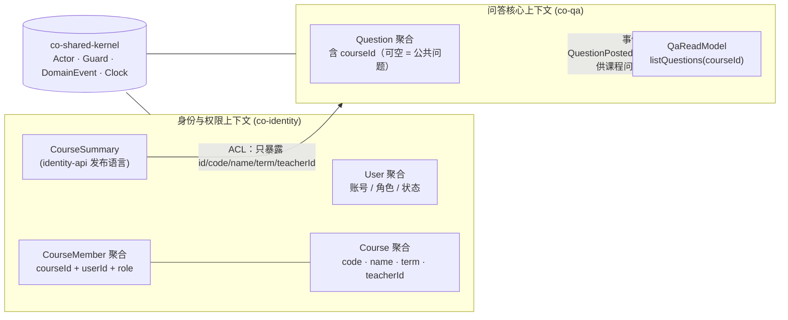

# Lab 3 · 课程与选课上下文（与代码对齐版 v2）

> 产出人：房国栋（Dev-2 前端与验证）　对应实验：Lab 3 领域驱动设计事件风暴（Sprint 1）
> 定位：`docs/domain/` 现有材料只覆盖 **Q&A 上下文**（`aggregates.md`）；本文件补 **课程** 这一块，支撑角色卡 **E1 课程页 / E2 提问选课**。
> **v2 修订说明**：v1 草案基于"课程尚未实现"的假设，建议把课程放进 `co-qa`；核对代码后发现 **课程已在 `co-identity` 完整落地**（聚合、仓储、应用服务、REST、JPA、Flyway 迁移俱全），问答侧也已预留 `courseId`。本版按真实实现重写，不再自说自话。

---

## 1. 现状核对（代码即事实）

| 层 | 类 / 文件 | 职责 | 状态 |
| --- | --- | --- | --- |
| 领域 | `identity/domain/Course.java` | 课程聚合根：`code`、`name`、`term`、`teacherId` | ✅ 已实现 + 3 个单测 |
| 领域 | `identity/domain/CourseMember.java` | 成员关系：`courseId + userId + role` | ✅ 已实现 |
| 领域 | `identity/domain/CourseRole.java` | `STUDENT` / `TEACHER`（+ 助教） | ✅ |
| 领域 | `identity/domain/CourseRepository.java` | 仓储接口（实现在 infrastructure） | ✅ |
| 应用 | `identity/application/CourseService.java` | `create / join / assignRole / listAll / myCourses / members` | ✅ |
| 接口 | `identity/interfaces/CourseController.java` | `/api/v1/courses` 6 个端点 | ✅ |
| 基础设施 | `CourseJpaEntity`、`CourseMemberJpaEntity`、`CourseRepositoryAdapter` | 持久化 | ✅ |
| 迁移 | `db/migration/identity/V202609010100__identity_init.sql` | 建表 | ✅ |
| 发布语言 | `identity/api/CourseSummary.java` | 供问答上下文消费的只读视图（ACL 出口） | ✅ |
| 问答侧 | `PostQuestionCommand.courseId`、`QuestionRef.courseId`、`QuestionDetailView.courseRef` | 课程维度已贯通 | ✅ |

> 结论：**课程上下文不是"待建"，而是"已建但没写进文档"**。所以本文件的重点是把它补进上下文映射、聚合清单与术语表，而不是设计新模块。

---

## 2. 领域事件（已实现 / 规划中）

| # | 事件 | 中文 | 所属聚合 | 触发点 | 状态 |
| --- | --- | --- | --- | --- | --- |
| 1 | CourseCreated | 课程已创建 | Course | `CourseService.create` | ✅ 已实现 |
| 2 | CourseMemberJoined | 课程成员已加入（含教师随建课自动绑定） | CourseMember | `create`（teacher）、`join`（student） | ✅ 已实现 |
| 3 | CourseMemberRoleChanged | 课程内角色已调整 | CourseMember | `assignRole` | ✅ 已实现 |
| 4 | CourseArchived | 课程已归档 | Course | — | ⬜ 未实现（US009/US010/US011 的归档场景依赖它） |
| 5 | CourseRosterSynced | 课程花名册已同步 | Course | — | ⬜ 未实现（教务导入，远期） |

时间线：`CourseCreated` → `CourseMemberJoined(TEACHER，建课人)` → `CourseMemberJoined(STUDENT，学生加入)` →（`CourseMemberRoleChanged` →）`CourseArchived`（学期结束）。

---

## 3. 命令 / 角色 / 事件 / 错误码

错误码是团队《错误码》文档里的真实编号，写进验收标准可直接对照 `docs/错误码.md`。

| 命令 | 触发角色 | 事件 | 聚合 | 关键规则 | 错误码 |
| --- | --- | --- | --- | --- | --- |
| 创建课程 | 教师 / 管理员 | CourseCreated + CourseMemberJoined | Course | 代码 2–20 位字母数字连字符；名称 2–50；学期 2–20；同学期同代码唯一 | `ID-3002` 无权限、`ID-1010/1011/1012` 字段非法、`ID-2004` 重复 |
| 加入课程 | 学生（登录用户） | CourseMemberJoined | CourseMember | 课程必须存在；同一人不能重复加入 | `ID-4002` 课程不存在、`ID-2005` 已加入 |
| 调整成员角色 | 课程教师 / 管理员 | CourseMemberRoleChanged | CourseMember | 目标必须是本课成员；课程教师角色不可降级 | `ID-3003` 无权限、`ID-4003` 非成员、`ID-1013` 不可降级 |
| 查询课程目录 | 任何人（带/不带登录） | — | Course（读） | 登录时附带"我在该课的角色" | — |
| 查询我的课程 | 登录用户 | — | CourseMember（读） | 只返回我加入的课 | — |

---

## 4. 聚合与不变式（对齐真实字段）

### 4.1 Course（聚合根）

| 字段 | 约束 | 依据 |
| --- | --- | --- |
| `code` | `^[A-Za-z0-9-]{2,20}$`，入库统一大写 | `Course.CODE`，`ID-1010` |
| `name` | 2–50 字 | `Guard.requireText`，`ID-1011` |
| `term` | 2–20 字（如 `2026-2027-1`） | `ID-1012` |
| `teacherId` | 创建者必须是教师或管理员 | `ID-3002` |
| 唯一性 | **同一学期内 `code` 唯一** | `CourseService.create` → `ID-2004` |

不变式清单（写进 Lab 3 聚合清单可直接用）：

1. 课程代码在同一学期内唯一，跨学期可复用；
2. 只有教师/管理员能创建课程，创建者自动成为该课程的 `TEACHER` 成员；
3. 课程一旦创建，`code`、`term`、`teacherId` 不可变（当前无 setter）；
4. 课程必须至少有一个 `TEACHER` 成员（建课时自动绑定，保证不为空）。

### 4.2 CourseMember（聚合根）

| 字段 | 约束 |
| --- | --- |
| `(courseId, userId)` | 业务唯一键，重复加入返回 `ID-2005` |
| `role` | `STUDENT` / `TEACHER` / 助教；`TEACHER` 不可被降级（`ID-1013`） |
| `joinedAt` | 加入时刻，插入后不可变 |

### 4.3 为什么成员关系是独立聚合（代码已按此实现）

| 方案 | 一致性 | 规模 | 结论 |
| --- | --- | --- | --- |
| Course 内嵌 `List<CourseMember>` | 强一致，但每次读课程都要加载全部成员 | 一门课几百人 → 聚合过大，并发加入频繁冲突 | ❌ |
| Course 与 CourseMember 分开，用 `CourseMemberRepository` 管理 | 加入时只需校验"课程存在"，天然弱一致 | 单条记录，读多写少 | ✅ **当前实现** |

> 判定依据：聚合边界围绕"必须立即一致的规则"。加入课程与课程信息之间只需弱校验（课程存在即可），无需同一事务锁住整门课。

---

## 5. 上下文映射（真实依赖）



### 5.1 关系说明

| 上游 → 下游 | 关系 | 落地方式 |
| --- | --- | --- |
| 身份/课程 → 问答 | **ACL（防腐层）+ 发布语言** | 问答只依赖 `identity-api` 的 `CourseSummary`，不引用 `identity-domain` 的 `Course`；`co-qa` 的测试里用 `StubIdentity` 伪造，说明边界确实生效 |
| 问答 → 课程 | 无反向依赖 | 课程不知道问题存在，课程问题数由问答事件投影（读模型）产生 |
| 身份内部 User ↔ Course | 同一上下文内的两个聚合 | `CourseService` 用 `UserRepository` 查教师姓名做视图拼装，属于同上下文协作，不算跨边界 |

### 5.2 与总图的关系

`docs/domain/context-map.md` 目前列的是 6 个上下文。本文件的结论是：**课程不是第 7 个独立上下文，而是"身份与权限上下文"内的一个子域**（因为"谁能加入课程"本质是授权问题，与 `User`/角色同源）。建议总图改成：

```
身份与权限（含课程子域） --(发布语言 CourseSummary)--> 问答核心
```

这样既符合代码，也避免"为了画图而拆模块"。

---

## 6. 缺口清单（E1/E2 落地前需要处理）

| 缺口 | 影响的验收场景 | 建议 | 负责 |
| --- | --- | --- | --- |
| `Course` 无 `archived/status` | US009"归档不可加入"、US010"归档后不出现"、US011"归档置灰" | 后端加 `status` 字段（`ACTIVE/ARCHIVED`）+ 归档用例；或由 PO 决定砍掉这三个场景 | 青岑 / PO |
| `CourseView` 无 `joinedAt` | US010"按加入时间倒序" | 后端补字段，或前端先按 `id` 倒序 | 青岑 |
| 无课程简介字段 | US009 卡片"一句话简介" | 用 `name + term + teacherName` 组合展示，不加字段 | 房国栋（前端） |
| 无"退出课程" | 无 | 不纳入本 Sprint | — |
| 前端无 `pages/courses/` | 全部 E1/E2 | 本次开发，见 `docs/backlog/course-stories.md` §5 | 房国栋 |
| 课程列表无分页 | 课程量小，暂不影响 | 后续加 `PageRequest` | 青岑 |

---

## 7. 术语增补（建议并入 `glossary.md` v1.1）

| 中文 | 英文 | 业务定义 | 所属上下文 |
| --- | --- | --- | --- |
| 课程 | Course | 由教师开设、学生可加入的问答单元 | 身份与权限（课程子域） |
| 课程代码 | CourseCode | `2–20` 位字母/数字/连字符，学期内唯一 | 同上 |
| 学期 | Term | 课程开设的时间范围，如 `2026-2027-1` | 同上 |
| 课程成员 | CourseMember | 用户与课程的成员关系，含角色与加入时间 | 同上 |
| 课程角色 | CourseRole | 成员在课程内的身份：学生 / 教师 / 助教 | 同上 |
| 加入课程 | JoinCourse | 学生建立与课程的成员关系 | 同上 |
| 我的课程 | MyCourses | 当前用户已加入的课程集合 | 同上 |
| 课程教师 | CourseTeacher | 课程的 `teacherId` 对应用户，拥有调整成员角色等权限 | 同上 |
| 课程归档 | CourseArchived | 学期结束后课程转只读（**尚未实现**） | 同上 |
| 课程归属 | CourseScope | 一条问题可挂在某一课程下，`courseId` 为空表示公共问题 | 问答核心 |
| 课程问题列表 | CourseQuestionList | 按 `courseId` 分页查询的问题列表（读模型） | 问答核心 |
| 课程管理员 | CourseManager | 可采纳/认证该课程内回答的角色（教师或助教） | 问答核心 |

---

## 8. 待确认问题（评审时抛出）

1. **归档要不要做**：三个 Gherkin 场景依赖它；若 Sprint 2 不做，需要 PO 同意把场景改成"课程不存在"。
2. **公共问题**：`QuestionRef.courseId` 是 `Long`（可空），意味着允许不挂课程的问题——与"问题必须挂课程"的直觉冲突，需明确产品规则。
3. **助教角色**：`CourseRole` 已含助教语义，但"助教能做什么"（能否采纳、能否加精）还没有规则文档。
4. **课程列表顺序**：当前 `findAll()` 无排序，UI 需要稳定顺序。

---

## 9. 与 Lab 3 提交物的对应

| Lab 3 提交物 | 本文件贡献 | 状态 |
| --- | --- | --- |
| 事件风暴现场照片 | 第 2 节补课程侧 5 张橙色卡（3 已实现 / 2 规划） | ✅ |
| 上下文映射图 PNG | 第 5 节 Mermaid 图，可导出 PNG | ⚠️ 待导出 |
| 聚合识别清单 Markdown | 第 4 节 Course / CourseMember 聚合、不变式、边界取舍 | ✅ |
| 统一语言术语表 v1.0 | 第 7 节 12 条，含真实错误码语境 | ⚠️ 待并入 v1.1 |
