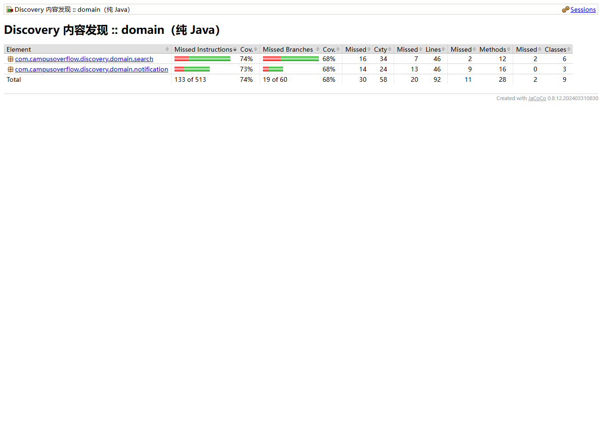

# 3. 质量证据

> 答辩口径：先给结论（门禁全绿、覆盖率达标、端到端可跑），再按需展开 CI 与报告。
> 数据截至：2026-11-16（S3 收口口径）。

## 3.1 CI 门禁（五个后端阶段 + 前端）

`.github/workflows/ci.yml`：

| 阶段 | 命令 | 作用 |
| --- | --- | --- |
| 1 编译 | `mvn -f backend/pom.xml clean compile` | 全仓编译 |
| 2 单元测试 | `mvn test -pl $SPRINT_MODULES -am` | Sprint 范围单元测试 |
| 3 架构约束 | `mvn test -pl co-bootstrap -Dtest=ArchitectureTest` | ArchUnit 分层/依赖（FF-4） |
| 4 覆盖率门禁 | `mvn verify -DskipITs -Djacoco.skip=false -pl $SPRINT_MODULES -am` | domain 行覆盖 ≥ 0.70 |
| 5 集成测试 | `mvn verify -Dsurefire.skip=true`，`continue-on-error` | S1–S3 允许失败（ADR-009） |
| 前端 | `npm run typecheck` + `npm run build` | 类型检查与构建 |

`SPRINT_MODULES` 在 S3 收口后为：

```text
co-shared-kernel,co-identity/co-identity-domain,
co-qa/co-qa-domain,co-qa/co-qa-application,
co-reputation/co-reputation-domain,co-reputation/co-reputation-application,
co-discovery/co-discovery-domain,co-discovery/co-discovery-application
```

## 3.2 测试与覆盖率

| 模块 | 测试数 | 行覆盖率 | 门槛 |
| --- | ---: | ---: | --- |
| co-shared-kernel | 2 | — | — |
| co-identity-domain | 9 | 75.74% | ✅ ≥70% |
| co-qa-domain | 30 | 83.12% | ✅ |
| co-qa-application | 28 | —（应用层不进门槛） | — |
| co-reputation-domain | 18 | 81.93% | ✅ |
| co-reputation-application | 21 | — | — |
| co-discovery-domain | 6 | 78.26% | ✅ |
| co-discovery-application | 6 | — | — |
| co-bootstrap | ArchitectureTest | — | 分层约束 |

> 覆盖率来自 JaCoCo `jacoco.csv` 汇总（LINE COVERED / (COVERED+MISSED)）；四个 domain 模块均通过 `check-domain-coverage`。



截图与原始数据：[`screenshots/coverage/`](screenshots/coverage/README.md)（`coverage-discovery.png` + `coverage-discovery.csv`）。

## 3.3 端到端与冒烟

- **T1-15 主链路脚本**：CSRF → 注册 → 登录 → 发问题 → 另一账号回答 → 投票 → 采纳 → 详情校验，`SMOKE PASS`（2026-11-15，demo profile + MySQL/Redis）；用法见 [`scripts/smoke/README.md`](../../scripts/smoke/README.md)。
- **搜索**：单字关键词 422 `DIS-1001`；中文词命中依赖 `SearchIndexProjector` 投影（S3 已实现）。
- **声誉/悬赏**：采纳 +15、悬赏 50 分结算/自答退款/到期退款均有日志与测试（[`docs/scrum/sprint-2.md`](../scrum/sprint-2.md) §六）。
- **demo profile**：`DemoDataSeeder` 6 账号 / 1 课程 / 3 问题，重启幂等（[`docs/reports/t2-14-demo-profile.md`](../reports/t2-14-demo-profile.md)）。

## 3.4 缺陷台账

[`docs/qa/defects.md`](../qa/defects.md) 当前：

| 状态 | 条目 |
| --- | --- |
| 已修复 | BUG-001 课程页、BUG-002 PR 无 CI、BUG-003 分支保护必需检查、BUG-004 DDD 不一致、BUG-005 提交身份、BUG-006 团队文档/ADR-009 |

BUG-003 于 2026-11-17 复核关闭：`main` 为 2 Approve + 后端/前端/容器三项必需检查，`develop` 为 1 Approve + 后端/前端两项必需检查（规则集 `develop required checks`，`enforce_admins=true`）；`容器镜像构建` 因 `if` 限定 `push` / `base=main`，只挂 `main`。证据见 [`docs/qa/defects.md`](../qa/defects.md#复核记录)。

## 3.5 发布验证

- `v0.1.0` → `704cd60`（S0 基线，补打）
- `v0.2.0` → `a381bb8`（S1 基线，补打）
- `v0.3.0` → `a4114dc`（main，PR #115）：CI 后端/前端/容器镜像三阶段绿

详见 [`docs/reports/release-v0.2.0-v0.3.0.md`](../reports/release-v0.2.0-v0.3.0.md)。
- 可观测性四面板与对账指标演练：[`docs/reports/t4-04-observability.md`](../reports/t4-04-observability.md)

## 3.6 复现命令

```powershell
# 全仓（27 模块）构建与测试
mvn -B -f backend/pom.xml verify -DskipITs -Djacoco.skip=false

# 仅 CI 的 Sprint 范围
mvn -B -f backend/pom.xml verify -DskipITs -Djacoco.skip=false `
  -pl "co-shared-kernel,co-identity/co-identity-domain,co-qa/co-qa-domain,co-qa/co-qa-application,co-reputation/co-reputation-domain,co-reputation/co-reputation-application,co-discovery/co-discovery-domain,co-discovery/co-discovery-application" -am
```

> 2026-11-16 实跑：全仓 27 个模块 `mvn verify -DskipITs -Djacoco.skip=false` → **BUILD SUCCESS**（含 ArchUnit 1 条）。

## 3.7 已知风险

| 风险 | 影响 | 处置 |
| --- | --- | --- |
| BUG-003 `required_status_checks` 为空 | 发布 PR 的 CI 失败不一定阻断合并 | 已于 2026-11-17 关闭：`main` 三项、`develop` 两项必需检查 + `enforce_admins`；改 CI 作业名后需同步核对，否则必需检查永远 pending |
| 本地 JDK 25 下 JaCoCo 0.8.12 agent 不兼容 | 本机取证需 `-Djacoco.skip=true` | 统一用 JDK 21 取证；CI 固定 21 |
| 集成测试仍允许失败 | 端到端问题可能漏过 CI | S4 彩排必须手工跑 T1-15 冒烟 + demo 走查 |
