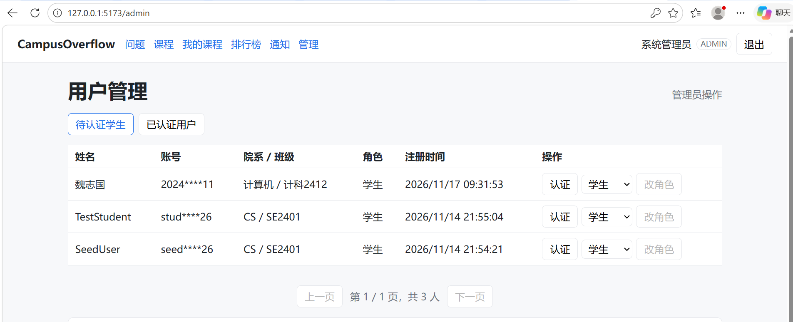
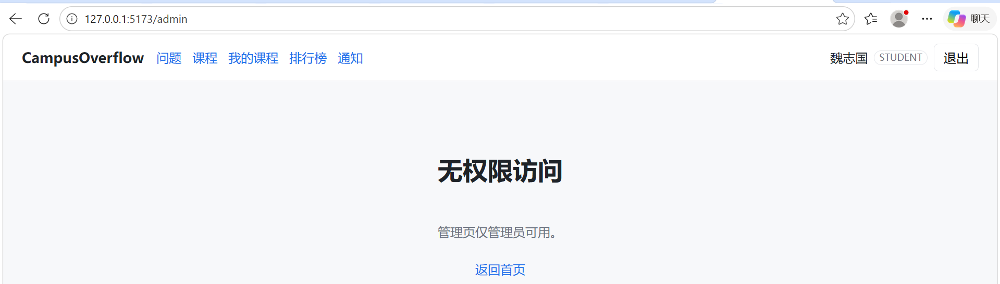

# CampusOverflow 用户手册

> 适用环境：本地 demo profile（MySQL + Redis + 后端 + 前端）
> 前端地址：<http://127.0.0.1:5173/>　后端地址：<http://localhost:8080/>
> 演示账号密码统一为 `Campus2026`

## 0. 准备

按根目录 [`README.md`](../../README.md) 的「五分钟跑起来」启动：

1. `docker compose -f deploy/docker-compose.yml up -d mysql redis`
2. 后端用 `demo` profile 启动；
3. `cd frontend && npm run dev`；
4. 打开终端打印的地址。若 `localhost:5173` 连不上，改用 `http://127.0.0.1:5173/`。

| 账号 | 角色 | 用途 |
| --- | --- | --- |
| `admin01` | 管理员 | 管理页、认证学生、建教职工、改角色 |
| `T2001` | 教师 | 课程教师、发起悬赏、教师认证回答 |
| `TA3001` | 助教 | 协助课程与悬赏 |
| `2023001` | 学生 | 提问、回答、投票、采纳、看通知 |
| `2023002` / `2023003` | 学生 | 互相回答、投票、制造通知 |

## 1. 注册 / 登录

1. 打开 <http://127.0.0.1:5173/login>。
2. 已有账号：在「登录」页输入学号/工号和密码，点「登录」。
3. 新学生：切到「注册」，填写学号/工号（4–20 位）、密码（8–64 位）、昵称、校园邮箱、学院、班级，点「注册并登录」。
4. 教师/管理员没有自助注册入口；演示环境直接用 `T2001` / `admin01`。

预期结果：登录后右上角显示昵称和角色；学生显示 `STUDENT`，管理员显示 `ADMIN`。

> 遇到 403 / CSRF 校验失败：刷新页面重新获取 `XSRF-TOKEN` 后再操作。

## 2. 浏览课程并加入

1. 顶部导航点「课程」，进入课程列表。
2. demo 数据中有 `CS2001 数据结构`。
3. 点课程卡片上的「加入课程」；已加入的课程可在「我的课程」查看。

预期结果：加入成功后，课程出现在「我的课程」，提问时可以选择这门课。

## 3. 提出问题

1. 登录学生账号（如 `2023001`）。
2. 首页点「我要提问」。
3. 填写：
   - 标题（10–150 字，尽量具体）；
   - 正文（Markdown，至少 20 字：说明尝试过什么、卡在哪里）；
   - 标签（1–5 个，空格或逗号分隔，如 `数据结构 红黑树`）；
   - 所属课程（可选，建议选 `CS2001`）。
4. 点「发布问题」。

预期结果：跳转到问题详情页，问题作者是你，页面显示票数、回答数、浏览数和标签。

## 4. 回答

1. 打开一条问题详情。
2. 在「写回答」文本框输入回答；支持 Markdown，代码用 ``` 包裹。
3. 点「提交回答」。

预期结果：回答出现在问题下方；回答者获得初始声誉（按声誉规则结算），问题作者会收到通知。

## 5. 投票与评论

### 投票

在问题或回答左侧点 `▲` / `▼`：

- `▲` 赞成，`▼` 反对；
- 再点一次同一按钮可取消；
- 未登录时按钮不可用，提示先登录。

### 评论

1. 在问题或回答下方点「添加评论」。
2. 输入评论；可以用 `@昵称` 提醒对方（昵称 2–20 个非空白字符）。
3. 点「发表」。

预期结果：评论按时间显示；被 `@` 的用户会收到通知。

## 6. 采纳答案

1. 用提问者账号打开自己的问题。
2. 在目标回答下点「采纳此回答」。

预期结果：

- 该回答出现采纳标记 `✔`；
- 回答者获得采纳声誉；
- 问题列表和详情显示「已采纳」；
- 相关通知与声誉流水可在通知页、声誉页查看。

## 7. 发起与结算悬赏

悬赏由课程教师/助教在问题详情页发起，回答被采纳后结算给回答者。

1. 用 `T2001`（教师）打开一条课程问题。
2. 在悬赏区域点「发起悬赏」。
3. 填写积分（10–500）和有效天数（1–14），点「发起悬赏」。
4. 用提问者账号采纳一个回答。

预期结果：

- 发起时教师的可用积分减少、冻结积分增加；
- 问题详情显示悬赏积分、发起人和倒计时；
- 采纳后悬赏状态变为已发放，回答者获得悬赏积分；
- 到期未采纳时按规则退款（以页面状态和声誉流水为准）。

> 发起悬赏需要教师/助教且必须是该课程的问题；学生直接发起会提示无权限。

## 8. 搜索与相关问题

1. 首页搜索框输入关键词，例如 `红黑树`。
2. 可配合「最新」排序、标签筛选和「仅看未回答」。
3. 打开任意问题详情，右侧/下方会显示「相关问题」。

预期结果：

- 中文关键词至少 2 个字符；单字（如 `树`）会返回 422 `DIS-1001`；
- 搜索命中问题的标题、正文和标签；
- 相关问题按共享标签的相似度排序，并显示相似度。

> 中文全文检索依赖 compose 中的 MySQL `ngram_token_size=2`；自建数据库参数不同会搜不到。

## 9. 通知

1. 登录后点顶部「通知」，红色角标是未读数。
2. 点击通知可跳到对应问题/回答。
3. 「标为已读」处理单条，「全部标记为已读」清空未读。

预期结果：

- 有人回答你的问题、采纳你的回答、教师认证你的回答、悬赏获奖、获得徽章或被 `@` 时产生通知；
- 只能看到和标记自己的通知。

## 10. 管理员：认证学生、建教职工、改角色

1. 用 `admin01` 登录，右上角应显示 `ADMIN`，导航出现「管理」。
2. 进入 <http://127.0.0.1:5173/admin>。
3. 「待认证学生」标签页：
   - 查看未认证学生列表（账号已脱敏）；
   - 点「认证」完成校园身份认证。
4. 「已认证用户」标签页：
   - 在角色下拉框选择新角色；
   - 点「改角色」；不能修改当前登录账号自己的角色。
5. 页面下方「创建教职工账号」：
   - 填工号、姓名、邮箱、初始密码、角色（助教/教师/管理员）、学院；
   - 点「创建账号」；学生账号请走注册流程，不能在这里创建。
6. 非管理员（如 `2023001`）：
   - 导航没有「管理」；
   - 直接访问 `/admin` 会显示「无权限访问」。





> 管理员页面的错误会直接显示后端返回的中文提示，例如“该用户已完成认证”“工号、昵称或邮箱已被使用”。

## 11. 常见问题

| 现象 | 处理 |
| --- | --- |
| 页面打不开 / 连接被拒绝 | 确认后端 8080、前端 5173 都在运行；用 `http://127.0.0.1:5173/` 打开 |
| 登录 403 / CSRF 校验失败 | 刷新页面；确认浏览器允许携带 Cookie |
| 搜索单字 422 | 关键词至少 2 个字符 |
| 中文搜索无结果 | 使用 compose 的 MySQL；等待 outbox 投影完成后再搜 |
| 看不到「管理」 | 当前账号不是 `ADMIN`；学生看不到入口，直接访问 `/admin` 显示无权限 |
| 悬赏按钮不可用 | 只有课程教师/助教可以发起悬赏；学生只能回答并等待采纳 |
| 通知/声誉没变化 | 事件异步投递，稍等几秒刷新；检查 `outbox_event.last_error` |
| 演示数据重复 / 缺失 | `demo` seeder 幂等；确认启动 profile 是 `demo`，且 MySQL/Redis 正常 |

## 12. 验收路径（建议）

```text
注册/登录
  → 加入课程
  → 提问
  → 另一个账号回答
  → 提问者采纳
  → 教师发起悬赏并采纳结算
  → 搜索“红黑树”并查看相关问题
  → 查看通知
  → 管理员认证学生/建教职工/改角色
```

每一步的页面、按钮和预期结果见上文对应章节；管理员入口与权限对比见 §10 的两张截图。
