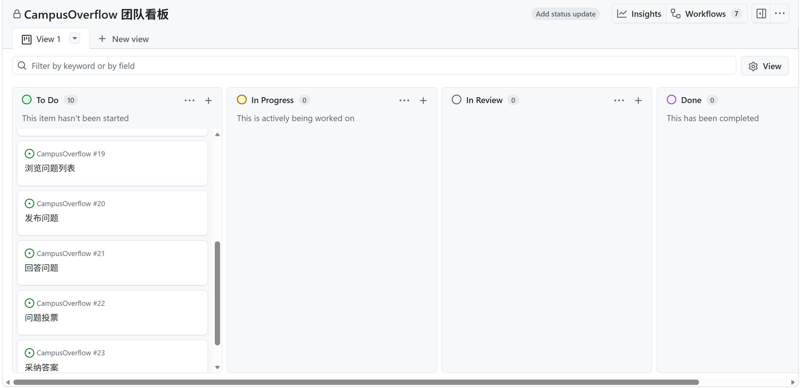
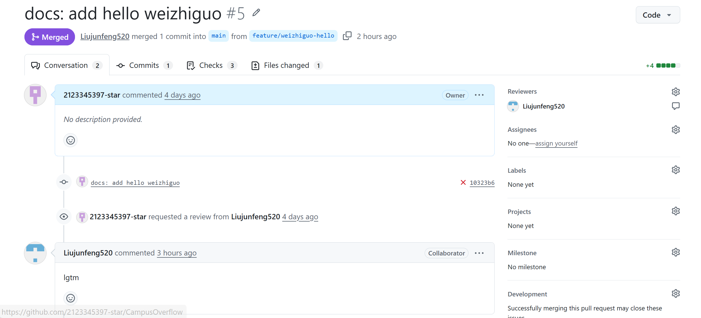
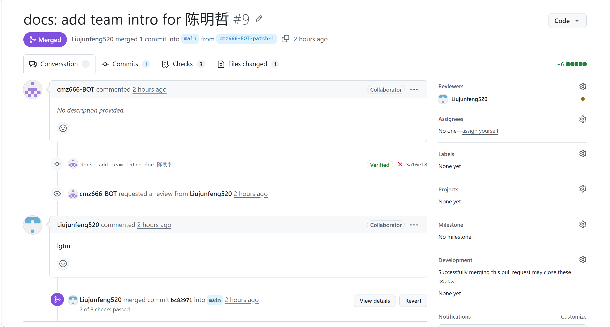
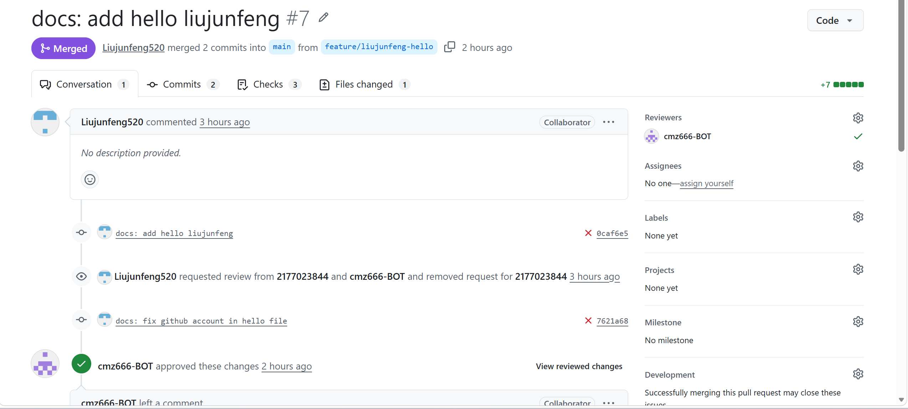
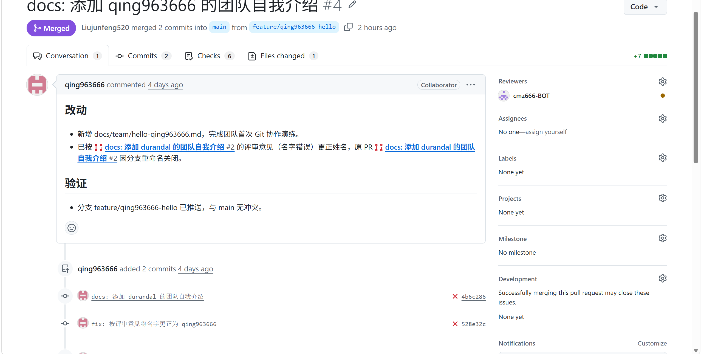
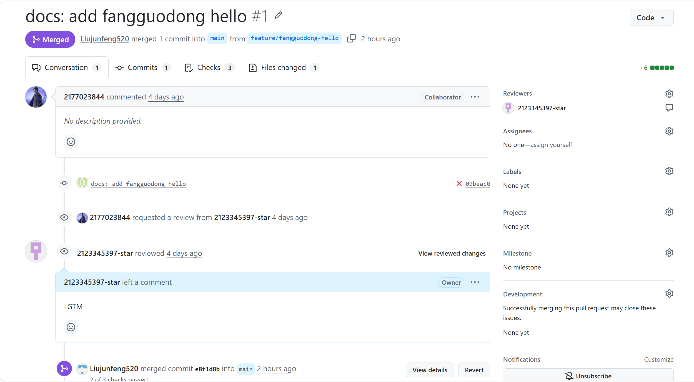

# Lab 1 提交物清单 · TeamX

> 团队：TeamX　项目：CampusOverflow 校园问答平台
> 仓库：<https://github.com/2123345397-star/CampusOverflow>
> 提交日期：2026-10-26　最近更新：2026-10-28　对应实验：Lab 1 团队组建与协作工具链（Sprint 0）

本文件是 Lab 1 的**提交索引**：老师按本页即可找到全部材料，不必翻聊天记录。

> 本目录下所有截图统一存放在 [`screenshots/`](screenshots/) 子目录。

---

## 1. 团队代码仓库 URL

- 仓库地址：<https://github.com/2123345397-star/CampusOverflow>
- 默认分支：`main`（最新提交 `e8fe706`，2026-10-27）
- 成员：5 人均已参与分支推送与 PR 协作
- 分支保护：要求为「禁止直推 + PR 至少 1 人审批 + CI 通过」；
  设置入口：Settings → Branches → Branch protection rules。
  **截图尚未补充**（`screenshots/branch-protection.png`），是本目录唯一未完成项。

## 2. 团队看板截图

- 文件：[`screenshots/lab1-board.png`](screenshots/lab1-board.png)　状态：✅ 已提交
- 要求：四列（`Backlog`/`To Do`、`In Progress`、`In Review`、`Done`）可见，`Backlog`/`To Do` 至少 5 条卡片。
- 卡片来源：[`backlog.md`](backlog.md)（Sprint 0 共 8 条）。



## 3. 团队章程 v1.0

- 文件：[`docs/team/charter-v1.0.md`](../team/charter-v1.0.md)　状态：✅ 已在 `main`
- 合并记录：PR [#6](https://github.com/2123345397-star/CampusOverflow/pull/6)，合并提交 `e1caa47`
- 签署：全体 5 人（魏志国、陈明哲、刘俊琒、青岑、房国栋），评审中含 1 个 Approve
- 覆盖章节：团队价值观、角色与职责、沟通约定、开发规约、DoD 初版、签字

## 4. 角色承诺书

- 文件：[`docs/team/role-commitment.md`](../team/role-commitment.md)　状态：✅ 已在 `main`
- 提交记录：`ed91cae`（`docs(lab1): 补全角色承诺书并整理 Lab1 提交物清单`）
- 内容：共同承诺 8 条 + PO / SM / Developer / QA 分角色承诺 + 全员签署表（5 人均已签署）
- 说明：PR [#3](https://github.com/2123345397-star/CampusOverflow/pull/3) 最初建立的是空文件，
  已由 `ed91cae` 按 5 人实际角色补全并进入 `main`，无需再等后续 PR。

## 5. 成员 PR 合并截图

每人一个 hello PR，均已合并到 `main`。截图统一放在 [`screenshots/`](screenshots/)，
命名规则 `pr-<拼音>.png`。

| 成员 | 角色 | PR | 分支 | 合并提交 | 评审记录 | 截图 |
| --- | --- | --- | --- | --- | --- | --- |
| 魏志国 | PO | [#5](https://github.com/2123345397-star/CampusOverflow/pull/5) | `feature/weizhiguo-hello` | `ee0b1a3` | Liujunfeng520 评论 | [`screenshots/pr-weizhiguo.png`](screenshots/pr-weizhiguo.png) |
| 陈明哲 | SM | [#9](https://github.com/2123345397-star/CampusOverflow/pull/9) | `cmz666-BOT-patch-1` | `bc82971` | 无 Review 记录 ⚠️ | [`screenshots/pr-chenmingzhe.png`](screenshots/pr-chenmingzhe.png) |
| 刘俊琒 | SM | [#7](https://github.com/2123345397-star/CampusOverflow/pull/7) | `feature/liujunfeng-hello` | `35c711e` | cmz666-BOT **Approve** | [`screenshots/pr-liujunfeng.png`](screenshots/pr-liujunfeng.png) |
| 青岑 | Developer / QA | [#4](https://github.com/2123345397-star/CampusOverflow/pull/4) | `feature/qing963666-hello` | `c6b16d3` | 无 Review 记录 ⚠️ | [`screenshots/pr-qingcen.png`](screenshots/pr-qingcen.png) |
| 房国栋 | Developer | [#1](https://github.com/2123345397-star/CampusOverflow/pull/1) | `feature/fangguodong-hello` | `e8f1d8b` | 2123345397-star 评论 | [`screenshots/pr-fangguodong.png`](screenshots/pr-fangguodong.png) |

### 截图

**魏志国 · PR #5**



**陈明哲 · PR #9**



**刘俊琒 · PR #7**



**青岑 · PR #4**



**房国栋 · PR #1**



### 其他团队协作 PR（非个人 hello，作为过程证据）

| PR | 内容 | 合并提交 | 评审 |
| --- | --- | --- | --- |
| [#6](https://github.com/2123345397-star/CampusOverflow/pull/6) | 团队章程 v1.0 | `e1caa47` | 青岑 **Approve** |
| [#3](https://github.com/2123345397-star/CampusOverflow/pull/3) | 角色承诺书（初始空文件，后由 `ed91cae` 补全） | `1a1e1a9` | 青岑 评论 |
| [#11](https://github.com/2123345397-star/CampusOverflow/pull/11) | 第一次站会纪要 | `e9a1224` | 2123345397-star 评论 |
| [#2](https://github.com/2123345397-star/CampusOverflow/pull/2) | 青岑 hello 初版（改名后关闭） | — | 房国栋 Request changes |

> 截图中应能看出 PR 标题、Author、Reviewer 的评论/Approve、Merged 状态。

## 6. 开发环境版本汇总（角色卡 E3）

- 文件：[`env-matrix.md`](env-matrix.md)　状态：⚠️ 采集口径与表格已就绪，**5 人版本与 `mvn clean test` 证据待采集**
- 采集脚本：[`scripts/dev-env/collect-env.ps1`](../../scripts/dev-env/collect-env.ps1) / [`collect-env.sh`](../../scripts/dev-env/collect-env.sh)
- 通过标准：Git 2.40+、JDK 21、Node.js 20+、Docker 可用；每人一份 `env-<拼音>.png` + 一份 `mvn-test-<拼音>.png`
- 已知情况：后端整体 `mvn clean test` 现阶段为红，原因是 `co-qa-domain` 的 `TODO(S2)` 桩尚未实现（TDD 先落测试），
  交付时按"整体红（附原因）+ 已实现模块绿"两段取证，避免被误判为环境问题。

## 7. 身份绑定核查（角色卡 E4）

- 文件：[`identity-audit.md`](identity-audit.md)　状态：⚠️ 已定位问题，整改进行中
- 审计脚本：[`scripts/dev-env/audit-authors.ps1`](../../scripts/dev-env/audit-authors.ps1) / [`audit-authors.sh`](../../scripts/dev-env/audit-authors.sh)
- 已有结论：仓库中存在作者 `baigui <W13636786666@163.com>`（如 `57dd52c`、`0c8f980`），该邮箱未在 GitHub 账号
  `2177023844` 内验证，贡献不会被统计；其余 4 人（`2123345397-star`、`cmz666-BOT`、`Liujunfeng520`、`qing963666`）待核查。
- 判定标准：`git config user.email` = GitHub 账号已验证邮箱（或 `用户名+ID@users.noreply.github.com`），
  且网页提交记录能点进本人主页。

---

## 提交物状态

| # | 提交物 | 路径 | 状态 | 负责人 |
| --- | --- | --- | --- | --- |
| 1 | 仓库 URL + 分支保护 | 本页第 1 节 | ⚠️ URL 已填，分支保护截图待补 | 刘俊琒 |
| 2 | 看板截图 | `screenshots/lab1-board.png` | ✅ 已提交 | 陈明哲 |
| 3 | 团队章程 v1.0 | `docs/team/charter-v1.0.md` | ✅ 已合并 | 魏志国 |
| 4 | 角色承诺书 | `docs/team/role-commitment.md` | ✅ 已在 `main` | 陈明哲 |
| 5 | 成员 PR 合并截图 | `screenshots/pr-<拼音>.png` | ✅ 5 张齐备 | 各成员 |
| + | 初始 Backlog | `backlog.md` | ✅ | 魏志国 |
| + | 环境版本汇总（E3） | `env-matrix.md` | ⚠️ 表格就绪，待 5 人采集 | 房国栋 |
| + | 身份绑定核查（E4） | `identity-audit.md` | ⚠️ 已定位 1 人未绑定 | 房国栋 |

图例：✅ 完成　⚠️ 部分完成　⬜ 待完成

---

## 验收自检

在仓库根目录执行：

```bash
# 1) main 上 hello 文档数量应为 5
git switch main && git pull --rebase
git ls-tree -r --name-only main docs/team | grep '^docs/team/hello-'

# 2) 章程与承诺书已在 main
git log --oneline -- docs/team/charter-v1.0.md docs/team/role-commitment.md

# 3) 协作历史：每人一个合并 PR
git log --oneline --graph --all --decorate -30

# 4) 无敏感文件
git ls-files | grep -E '(^|/)\.env$|node_modules/|/target/|/dist/'
```

检查结果（2026-10-27 复核）：

- [x] `main` 上共有 5 份 `hello-*.md`：fangguodong、chenmingzhe、liujunfeng、qing963666、weizhiguo
- [x] 章程经 PR #6 合并，评审含 Approve
- [x] 角色承诺书已补全并进入 `main`（提交 `ed91cae`）
- [x] 看板截图已提交：`screenshots/lab1-board.png`
- [x] 5 位成员的 PR 合并截图已提交：`screenshots/pr-*.png`
- [ ] 分支保护截图：`screenshots/branch-protection.png` 待补

---

## 还差什么

只剩 3 项：

1. **补分支保护截图**：Settings → Branches，确认 `main` 的规则（禁止直推 + PR 至少 1 人审批 + CI 通过）
   存在；截图保存为 `screenshots/branch-protection.png`，然后更新本页第 1 节状态。
2. **E3 环境采集**：5 人各跑一次 `scripts/dev-env/collect-env.ps1`（或 `.sh`），把输出行贴进
   [`env-matrix.md`](env-matrix.md)，并补 `env-*.png` / `mvn-test-*.png` 截图。
3. **E4 身份整改**：房国栋按 [`identity-audit.md`](identity-audit.md) 第 5 节绑定邮箱，其余 4 人填核查表。

---

## 评分要点对照

| 评分项（占比） | 对应材料 | 状态 |
| --- | --- | --- |
| 工具链配置完整性（30%） | 仓库、分支保护、看板、IM 群 | 仓库 ✅ / 看板 ✅ / 分支保护截图待补 |
| 团队章程质量（30%） | 章程 v1.0 是否具体可执行 | ✅ 已合并，含价值观、沟通、规约、DoD、签字 |
| Git 协作熟练度（30%） | 分支、PR、评审、合并流程 | ✅ Lab 1 期间 8 个 PR 已合并；2 个 PR 缺正式 Review |
| 团队氛围与协作（10%） | 课堂观察、站会记录 | ✅ `docs/team/daily-standup-01.md` |
