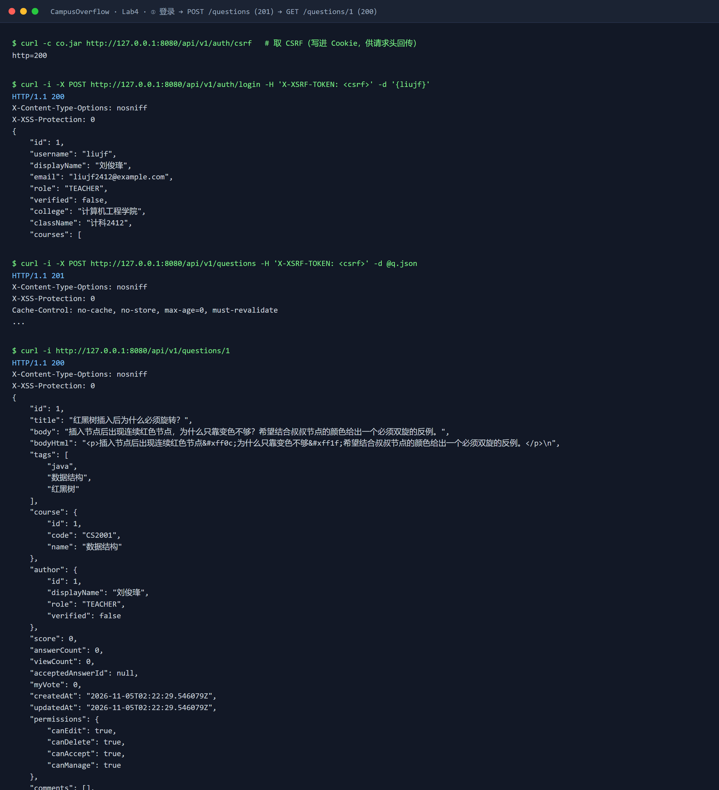
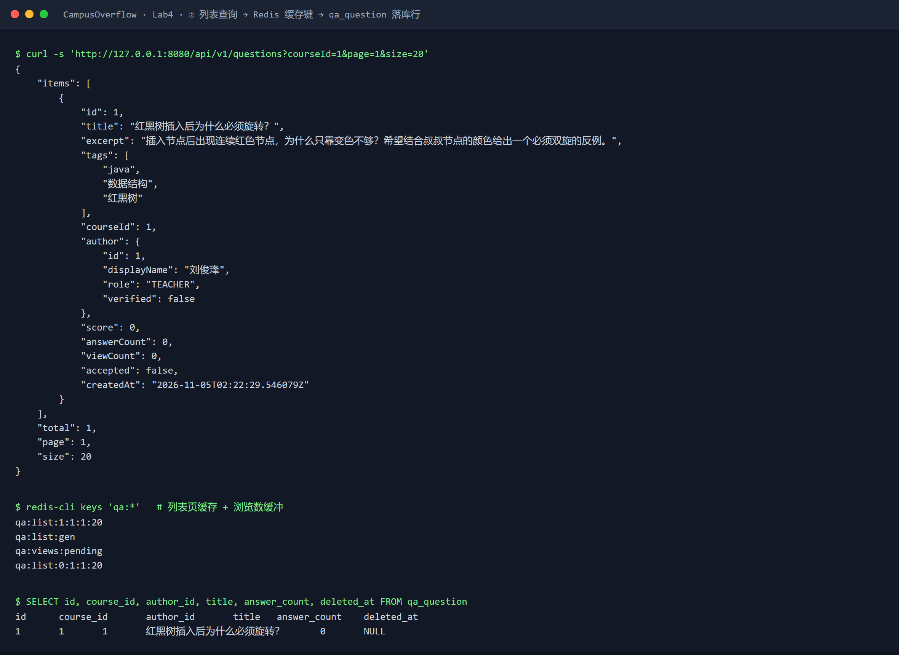

# Lab 4 提交物 · 角色卡 A（Q&A 问题侧）

> 姓名：刘俊琒　学号：2024121117　角色：A · Q&A 问题侧（Sprint 1 的 SM）
> 分支：`feat/qa-question`　PR：[#86](https://github.com/hbuas-se-2026fall/cs2412-team04-campus-overflow/pull/86)

本页是 Lab 4（后端工程骨架与领域代码）中**我负责部分**的交付索引：改了哪些代码、怎么验的、还剩什么。

---

## 1. 交付清单（T1-01 / T1-02 / T1-07 / T1-10 / T1-11）

| 任务 | 文件 | 内容 |
| --- | --- | --- |
| T1-01 值对象 | `co-qa-domain/.../MarkdownBody.java`、`Tags.java` | 正文按码点校验（问题 20–30000、回答 10–30000）；标签去重、保序、转小写，归一化后再判 1–5 个 |
| T1-02 Question 聚合 | `co-qa-domain/.../Question.java` | `post` / `edit` / `accept` / `softDelete` / `ensureOpenForAnswers` / `ensureNotDeleted`；删回答保护 QA-1013、重复采纳 QA-2002、已删统一 QA-1020 |
| T1-07 命令服务 | `co-qa-application/.../command/QuestionCommandService.java` | `post` 校验课程 → 构造值对象 → `save` → 标签用量 +1 → `QuestionPostedEvent`（正文走 `toPlainText`）→ 列表缓存失效 → 审计；`edit` 按标签差集 ±1；`delete` 软删 + `ContentDeletedEvent`；`load` 不存在或已删统一 404 |
| T1-10 查询服务 | `co-qa-application/.../query/QuestionQueryService.java` | `list` 缓存优先 + `findUsers` 批量补作者 + 摘要 160 字；`detail` 渲染安全 HTML、回答按「已采纳 → 得分降序 → 时间升序」、投票 key `QUESTION:{id}`/`ANSWER:{id}`、权限视图、浏览数只写 Redis；`popularTags` limit 夹在 1–50 |
| T1-11 发布语言 | `co-qa-application/.../QaQueryApiImpl.java` | `findQuestion` 把聚合映射成 `QuestionRef`（id / 作者 / 课程 / 标题 / 采纳回答 / 已删除标记）；查不到返回 `empty`，不抛异常 |

## 2. 测试

| 测试类 | 条数 | 结果 | 覆盖点 |
| --- | --- | --- | --- |
| `co-qa-domain` 全模块 | 33 | ✅ 全绿 | 含本次新增的 12 条边界用例 |
| `QuestionTest`（含 `Boundaries`） | 24 | ✅ | 标题 9/10/150/151、正文 19/20/30000/30001、标签去重后 5/6、重复采纳、已删问题编辑 |
| `QuestionCommandServiceTest` | 9 | ✅ | 事件恰好一次、标签差集、缓存失效、404/403/422 分支 |
| `QuestionQueryServiceTest` | 6 | ✅ | 缓存旁路、作者回填、投票键、答案排序、limit 夹取 |
| `QaQueryApiImplTest` | 4 | ✅ | 字段映射、公开提问的空值、不存在返回 empty、已删标记 |

运行：

```bash
mvn -f backend/pom.xml -pl co-qa/co-qa-domain -am test
mvn -f backend/pom.xml -pl co-qa/co-qa-application -am test \
    -Dtest='QaQueryApiImplTest,QuestionCommandServiceTest,QuestionQueryServiceTest'
```

> `co-qa-application` 全量 28 条中有 2 条红（`AnswerAndVoteServiceTest` 的 `submitAnswerPublishesEventAndBumpsCounter`、`onlyAskerOrCourseManagerCanAccept`）。
> 这两条属 B（魏志国）的 T1-03，在**干净的 `develop` 工作树**上同样失败（断言期望 1L/2L 与实际 2L/1L 对调），不是本 PR 引入；已在 PR 里留给 B 处理。

## 3. 端到端验证（POST → GET，数据库确认落行）

环境：MySQL 8.0.44 + Redis 5.0.14（Windows 移植版，本机实例），`dev` profile，Flyway 建表；账号 `liujf`（教师）建课 `CS2001 数据结构` 后发布问题。





关键结果：

- `POST /api/v1/questions` → `201`，返回 `{"id":1}`；
- `GET /api/v1/questions/1` → `200`，`bodyHtml` 已渲染、`permissions.canEdit/canManage` 为真；
- `GET /api/v1/questions?courseId=1` → `total=1`，Redis 出现 `qa:list:1:1:1:20`（列表缓存）与 `qa:views:pending`（浏览数缓冲）；
- `SELECT ... FROM qa_question` → 恰好一行，`answer_count=0`、`deleted_at=NULL`。

## 4. 还没做完 / 需要别人接手

1. **PR 需要 E 或 B 点 Approve**：GitHub 上作者不能批准自己的 PR，我这侧只能把描述、证据和自检结果补齐。
2. `AnswerAndVoteServiceTest` 的 2 条红（B 的 T1-03），CI 因此仍是红的；本 PR 的 19 条测试全绿，切到干净 `develop` 也一样红，可据此排除是我引入。
3. `docs/scrum/sprint-1.md` 与燃尽图更新（SM 职责，评审前完成）。
