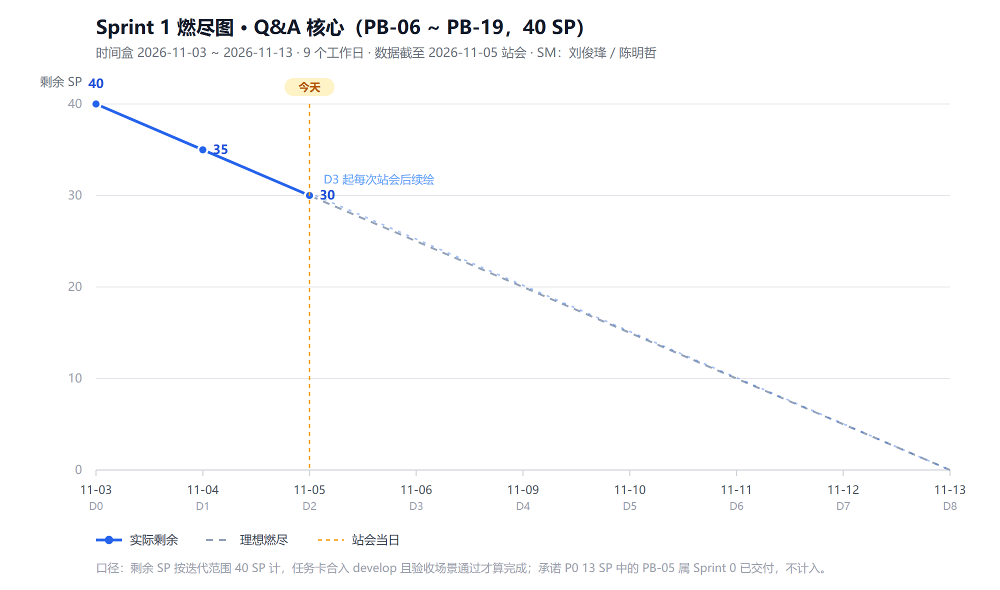

# Sprint 1 · 执行记录（Q&A 核心）

> Scrum Master：刘俊琒（A）、陈明哲（E）　PO：魏志国
> 时间盒：**2026-11-03（周二）～ 2026-11-13（周五）**，共 9 个工作日
> 计划与容量基线：[`docs/sprint/sprint-1-plan.md`](../sprint/sprint-1-plan.md)；范围来源：[`docs/backlog/product-backlog.md`](../backlog/product-backlog.md)
> 燃尽图：[`sprint-1-burndown.png`](sprint-1-burndown.png)
> 评审演示脚本（8 条验收场景的点选步骤）：[`sprint-1-demo.md`](sprint-1-demo.md)

---

## 一、Sprint 1 计划会（2026-11-03）

**结论（可查证产出）**

| 议题 | 结论 | 落地物 |
| --- | --- | --- |
| Sprint 目标 | 打通「注册 → 发布问题 → 列表 → 详情」的 Walking Skeleton，问题侧链路在真实数据库落一行 | `docs/sprint/sprint-1-plan.md` |
| 容量 | 5 人 × 10 天 × 4h × 0.7 = 140h ≈ 35 SP，承诺上限 70% ≈ 24.5 SP | 同上「一、团队容量计算」 |
| 承诺范围 | P0 = US-01～US-04（PB-05 3 + PB-06 5 + PB-07 3 + PB-08 2）= **13 SP** | 同上「二、Sprint 1 承诺目标」 |
| 迭代范围 | Sprint1 = PB-06～PB-19 = **40 SP**，P0 之外按剩余容量滚动 | backlog「迭代点数合计」 |
| 分工 | E 骨架与 CI；A 问题聚合与命令/查询；B 回答、投票、评论；C 发现与通知；D 前端 | plan「四、任务拆解」 |

**Sprint 1 我们决定不做的事**：Reputation / 悬赏（PB-20～PB-30）整体留到 Sprint 2；Sprint 1 只保留 PB-06～PB-19 的 Q&A 主线，避免 P0 被 S2 的范围稀释。

## 二、每日站会记录

> 三问：昨天完成什么 / 今天做什么 / 有什么阻塞。时间为站会当日 10:00，时长 ≤15 分钟。

### 2026-11-04（周三）

| 成员 | 昨日完成 | 今日计划 | 阻塞 |
| --- | --- | --- | --- |
| 陈明哲 E | 事件风暴 30 事件（4 上下文）、团队文档、ADR-009、CI 初版 | 骨架核对、CI 跑通 | 无 |
| 刘俊琒 A | 48 条 PBI 与 Sprint 范围对齐 | Question 值对象与聚合开工 | 等领域层基线 |
| 魏志国 B | PO 视角梳理 PB-05～PB-19 验收口径 | Answer 聚合 | 无 |
| 青岑 C | D3 上下文映射与 ACL 说明 | VoteService / CommentService | 无 |
| 房国栋 D | 前端行走骨架 | 问题列表页骨架 | 接口字段未定 |

**站会后动作**：青岑当日完成 `VoteService`、`CommentService` 并经 PR #78 合入 `develop`（PB-11、PB-15 任务卡完成）。

### 2026-11-05（周四）

| 成员 | 昨日完成 | 今日计划 | 阻塞 |
| --- | --- | --- | --- |
| 陈明哲 E | 行走骨架空实现、S1 渐进门禁（PR #85） | Reputation 对账与 S2 门禁（PR #87） | 无 |
| 刘俊琒 A | 领域层基线对齐（`Question` 改 `Long id`、14 参重建） | 命令/查询服务、T1-11、端到端 POST→GET | CI 在 QA 应用层红 |
| 魏志国 B | `AnswerCommandService` 与事件参数修正 | 回答与采纳用例回归 | 事件字段顺序待确认 |
| 青岑 C | 投票、评论服务合入 | 通知投影 | 无 |
| 房国栋 D | 列表页骨架 | 详情页联调 | 详情接口未发布 |

**站会后动作**

- 刘俊琒完成 `QuestionCommandService`（T1-07）、`QuestionQueryService`（T1-10）、`QaQueryApiImpl.findQuestion`（T1-11），并补 12 条边界用例；qa-domain 33 条、问题侧应用层 19 条全绿。
- `POST /api/v1/questions` → 201 → `GET /api/v1/questions/1` → 200 → 列表 `total=1` → `qa_question` 落库一行，证据见 [`docs/lab4-submission/`](../lab4-submission/README.md)。
- **阻塞升级**：`AnswerAndVoteServiceTest` 2 条在 `develop` 上即为红（期望 1L/2L 与实际 2L/1L 对调），卡住 CI 与 PR #86 合并；已定位到 `AnswerCommandService` 构造事件的参数顺序，转 B 处理。

## 三、燃尽图与数据

口径：纵轴为 Sprint 1 **迭代范围 40 SP**（PB-06～PB-19）中尚未完成的部分；「完成」指任务卡代码合入 `develop` 且对应验收场景通过。承诺 P0 的 13 SP 含 Sprint 0 已交付的 PB-05（3 SP），不计入本图。

| 日期 | 工作日 | 理想剩余 | 实际剩余 | 当日完成 |
| --- | --- | --- | --- | --- |
| 11-03 | D0 | 40 | 40 | 计划会，未开工 |
| 11-04 | D1 | 35 | 35 | PB-11 投票（3）、PB-15 评论（2） |
| 11-05 | D2 | 30 | 30 | PB-09～PB-13 的问题侧代码完成，待随 PR #86 合并 |
| 11-06 起 | D3～D8 | 25 → 0 | 待续绘 | 每次站会后由 SM 更新 |

## 四、风险与对策

| 风险 | 影响 | 对策 | 状态 |
| --- | --- | --- | --- |
| CI 在 `AnswerAndVoteServiceTest` 红 | PR #86 无法合并，S1 门禁不通过 | 已定位为事件构造参数顺序错位，转 B 修；同时在 PR 中附「干净 `develop` 同样失败」的证据排除本方引入 | 处理中 |
| 作者不能批准自己的 PR | PR 停在 `blocked` | 已指定 E（@cmz666-BOT）评审，站会上当面确认 | 处理中 |
| 本机无 Docker，MySQL/Redis 起不来 | 端到端无法验证 | 用 MySQL 8.0.44 临时实例（3307）+ Redis 5.0.14 移植版启动，`spring.config.additional-location` 覆盖数据源 | 已解除 |
| 事件字段顺序缺少契约测试 | 跨上下文消费方静默错位 | 建议在 `co-qa-api` 事件 record 上加构造顺序注释，并由 B 补契约测试 | 待办 |

## 五、评审前检查清单

- [x] Sprint 1 计划与容量计算在仓库中（`docs/sprint/sprint-1-plan.md`）
- [x] 每日站会有记录、燃尽图有折线（本文件 + `sprint-1-burndown.png`）
- [x] 任务卡与责任人对齐（T1-01～T4-03）
- [x] P0 的验收场景有对应实现与证据（`docs/lab4-submission/`）
- [ ] CI 全绿（依赖 B 修复 `AnswerAndVoteServiceTest`）
- [ ] PR #86 获得 ≥1 名非作者 Approve
