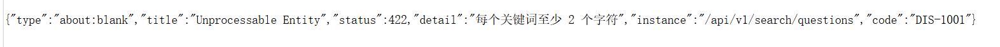

# Sprint 3 · 搜索与相关问题验收（进行中）

> 负责人：青岑（C）　范围：T3-01 / T3-02 / T3-05
> 环境：demo profile，MySQL/Redis Docker，`http://localhost:8080`

## 1. 已验证

### 单字关键词返回 422 DIS-1001

```http
GET /api/v1/search/questions?q=树
```

```json
{"type":"about:blank","title":"Unprocessable Entity","status":422,
 "detail":"每个关键词至少 2 个字符","instance":"/api/v1/search/questions","code":"DIS-1001"}
```



结论：`SearchQuery` 的 ngram 最小长度校验生效，T3-01 验收通过。

## 2. 阻塞已解除

最初 `q=红黑树` 返回 `total=0`，原因是 `SearchIndexProjector` 尚未实现（截图见
[`sprint-3-search-empty.png`](sprint-3-search-empty.png)）。

该投影器已由 PR #120 合并（`SearchIndexProjector` 10 个 TODO 清零），
重新编译并用 demo profile 启动后，新建两条带“数据结构 / search-test”标签的问题，
等待 outbox 投影完成，再执行搜索。

## 3. 中文搜索与相关问题：通过

```text
Search term: 红黑树
Search total: 2
  hit id=8, title=搜索验收：红黑树的黑高为什么不变量不能破坏？
  hit id=7, title=搜索验收：红黑树插入后为什么必须旋转？

Related count: 1
  related id=8, similarity=1.0
```

执行日志：[`sprint-3-search-hit.log`](sprint-3-search-hit.log)。

结论：

- 中文 ngram 搜索命中 2 条，`total=2`；
- 相关问题按共享标签返回 1 条，Jaccard 相似度 1.0；
- 搜索结果和 related 都经过 `DiscoveryQueryService`，T3-05 端到端通过。
