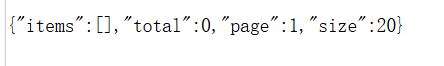

# Sprint 3 · 搜索与相关问题验收（进行中）

> 负责人：青岑（C）　范围：T3-01 / T3-02 / T3-05
> 环境：demo profile，MySQL/Redis Docker，`http://localhost:8080`

## 1. 已验证

### 单字关键词返回 422 DIS-1001

```http
GET /api/v1/search/questions?q=树
```

```json
{"type":"about:blank","title":"Unprocessable Entity","status":422,
 "detail":"每个关键词至少 2 个字符","instance":"/api/v1/search/questions","code":"DIS-1001"}
```


结论：`SearchQuery` 的 ngram 最小长度校验生效，T3-01 验收通过。

## 2. 当前阻塞

```http
GET /api/v1/search/questions?q=红黑树
```

```json
{"items":[],"total":0,"page":1,"size":20}
```



原因：`SearchIndexProjector` 还有 10 个 TODO（`firstTime` + 9 个 `on`），
搜索索引 `dis_search_doc` 没有被写入，不是 `DiscoveryQueryService` 的问题。
依赖负责人：A 刘俊琒。

## 3. 投影器完成后的待验项

- `GET /api/v1/search/questions?q=红黑树` 返回 `total > 0`
- `GET /api/v1/questions/{id}/related?limit=5` 返回带 `similarity` 的相关问题
- 搜索结果包含作者昵称、标签、采纳/悬赏状态
